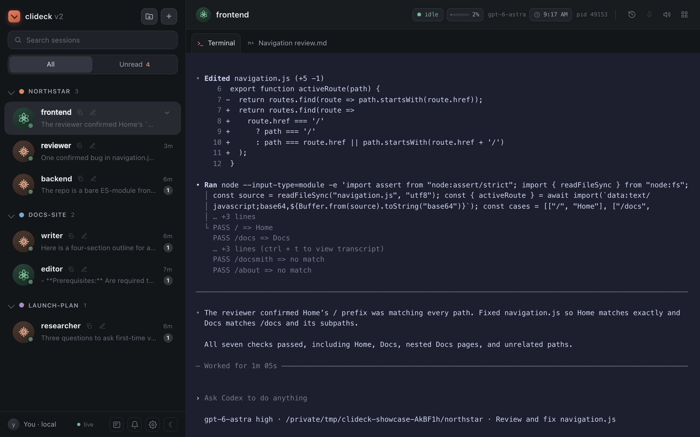
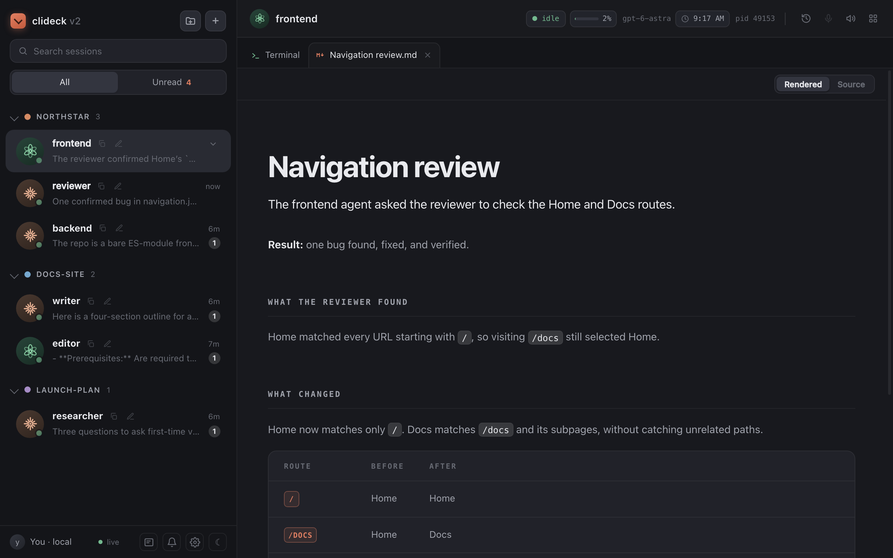
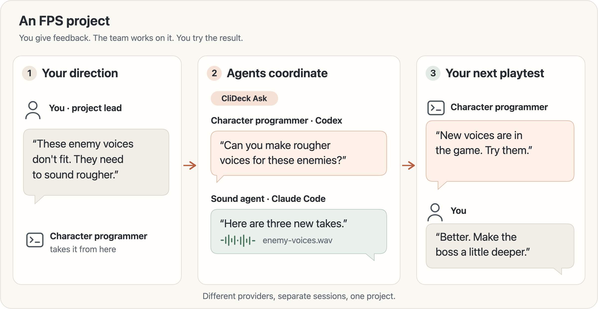

# clideck

A local workspace for CLI agents.

Run Claude Code, Codex, Gemini CLI, OpenCode, Pi, and shell sessions in one browser
window. Group them into projects, follow their progress, and pick up conversations
where you left off. Each session is the agent's actual terminal, with its own
tools, configuration, and account. Agents can open their work directly in CliDeck
for you to review as they go.



*Projects and sessions on the left; the selected agent's terminal on the right.*

## What’s new in 2.7.0

**Give your agents access to Google Workspace.** Ask an agent to find a client’s email in Gmail, check the meeting time in Calendar and draft a brief in Docs using files from Drive and figures from Sheets. Enable Google Workspace in Settings. For each account, choose which projects and agents can use it, which services they can reach and whether they can make changes. Set a default account for each project or let an agent request a connection for you to approve.

Setup works without an open session. CliDeck prepares the Google helper on supported Mac and Ubuntu systems. Open or copy the Google sign in link, then use the shortcut beside your newly connected account to set up access. You can check, reconnect or disconnect accounts from the same screen.

**Let an agent watch for you.** Ask it to tell you when a build finishes, a report changes or a new item arrives. The engine runs the checks while your computer is awake. Open Monitors to see the schedule, the last five results and which session gets the finding. Filter for checks that need attention, run one now, pause or resume it, clear a pending delivery or delete the check.

**Take a session with you.** Pair Telegram to give a Claude or Codex session its own private topic. Choose which sessions reach your phone while you’re away. For WhatsApp, scan the QR code in the experimental Chat apps plugin and link an agent to a group where you’re the only member. You can send a test, see pending messages and receive a working status and the final reply in that group. Switching windows keeps the reply connected to your phone.

**Talk to your agent.** Ask for a recap and give your Claude or Codex session its next task by voice. Preview voices before turning on the microphone. The waveform shows when the agent listens or speaks. Switching sessions stops the microphone. See voice minutes and estimated cost by day or session. Experimental phone controls also let you supervise outbound calls with a compatible carrier setup.

**Arrange your workspace.** Drag a session to the exact spot you want in its project or another project. The sidebar scrolls as you drag and remembers the order. Drag document tabs like browser tabs or scroll the strip with the mouse wheel. A selected tab slides into view with its close button clear of the toolbar. Switching sessions opens the terminal. Clicking a document notification opens that document.

**Keep a conversation.** Copy a single message or the whole conversation. Download the full saved history as text or Markdown, even when you’re looking at search results or only the latest messages are on screen.

**Find tools and busy processes.** Open the sidebar footer menu for the prompt library, Task Manager, Monitors, plugins and theme. A dot flags monitors that need attention. The session header keeps history, microphone, reading and session actions together. Task Manager groups jobs under their agents and shows shorter process names. Click Process, CPU, RAM, Running or PID to sort. Click again to reverse it. CliDeck remembers your choice.

**Try the desktop preview.** Build it from source on GitHub to open your existing projects and sessions in a desktop window. Native menus, keyboard shortcuts, a collapsible sidebar, unread badges and notifications help you jump to the right agent. Closing the window leaves agents running. Desktop settings cover links, the system tray and opening at login on supported platforms. If startup stalls, you can retry or open the engine logs.

**Read the terminal at a glance.** The context meter turns yellow at 25%, orange at 50% and red at 70%. The last reply clock flags a possible prompt cache expiry after 30 idle minutes for Codex or 60 for Claude Code. Hover or focus it for the token count. Local web addresses and file paths beginning with `~/` are clickable in the terminal. Plain web links work in Markdown previews too.

**Control what you hear.** Turn word highlighting and automatic scrolling off while a document keeps playing. Turn them back on to pick up at the current words. The player remembers your choice and has a separate button to stop and close it. Supertonic reads English dates, ranges, durations and amounts such as “50K” more naturally.

**Other workspace changes.** Agents get an explanation when a monitor or preview fails and a receipt when a reading finishes. Their notifications stay visible until you open the session or dismiss them. Settings lists every bundled plugin, including the four new optional plugins, and labels the folder picker for downloaded plugins. Plugin cards support setup buttons and show their own icons. Menus return keyboard control to the window they open. Missing project folders now get a specific error. When a newer interface is ready, you can refresh the browser while your sessions keep running.

## Quick start

Requires **Node.js 22.12+** and an installed agent CLI.

```sh
npm install -g clideck@2
clideck
```

Open **http://127.0.0.1:4000**, create a project, and add sessions. Mix providers
as needed. You can also run `npx clideck@2`.

## Working with sessions

The interface works like a WhatsApp conversation list: message previews, unread
counts, and activity times let you follow many sessions while working in one.

- **Projects.** Group sessions by working folder; drag them between projects.
- **Live status.** See who is working, idle, or needs your attention. Browser and
  sound notifications let you know when work finishes.
- **Resume and history.** Reopen saved sessions, read earlier conversations, and
  see when stopped sessions were last used. Back up your setup and restore selected
  settings, projects or sessions.
- **Search.** Find sessions and search their conversation text. Conversation
  History searches the full saved conversation with highlighted matches, and
  offers Jump to latest when new messages arrive without moving your reading
  position. Ctrl/Cmd+F in the terminal searches retained scrollback, with
  highlights that stay visible as you scroll. Filter to unread sessions when
  catching up.
- **Task Manager.** See running processes, CPU and memory use, grouped by project
  and agent. Open Task Manager from the sidebar footer menu. Filter, expand child
  processes, and stop a selected job after confirmation. It refreshes only while
  open and visible; available on macOS and Linux.
- **Saved prompts.** Type `//` to reuse a prompt. `{{session_name}}` and
  `{{project_name}}` fill in the current context.
- **Controls.** Light and dark themes and configurable shortcuts.

Agent-initiated failures return to the agent: command errors use the CLI response,
and later monitor or preview failures send a diagnostic message to the initiating
session. Background notices wait while it is busy or you are typing, survive an
engine restart, and do not repeat during the same failure. A recovered or removed
operation clears its notice. Uncertain submissions are never automatically resent.
Use `clideck errors` in the initiating session to inspect notices. After checking
an interrupted paste, `clideck errors acknowledge <id>` clears its uncertainty
without resending it and allows later background messages through.

## Monitors

Ask an agent to watch something, then open **Monitors** from the sidebar footer menu to see
its checks, findings, errors and delivery status. Pause, resume, check now or
delete a monitor there. Commands run independently of agent sessions, while the
CliDeck engine is running and the computer is awake. After upgrading, restart the engine and refresh your browser to use monitors.

From a CliDeck session:

```sh
clideck monitor add --name "Report changes" --every 5m --run 'cat report.txt'
clideck monitor add --name "Export ready" --every 1m --mode until-success --run 'test -f export.done'
clideck monitor add --name "Morning check" --at 09:00 --run 'date'
clideck monitor list
clideck monitor pause <id>
```

- Each finding arrives as one line with the monitor name, a summary and a
  `clideck monitor read <event-id>` command for the receiving session.
- The default target is the creating session. `--wake "@project/session"` selects
  another; `--resume-session` explicitly allows reopening its saved conversation.
  Missing resume metadata or a changed native conversation is reported, never
  silently treated as a fresh conversation.
- Default **change** mode saves the first successful output as a baseline, then
  reports changes. **items** mode expects a JSON array with stable `id` fields;
  it remembers up to 4,000 IDs without evicting them. It reports only IDs absent
  from the initial baseline and not already observed. Same-ID edits are ignored.
- **until-success** waits for exit code 0, delivers once, then completes. Exit 1
  means not ready; other exit codes are errors. `--once` stops a change/items
  monitor after its first delivery. `--at` is one-shot: the next `HH:mm` in the
  engine's local timezone, or an ISO date with an explicit timezone offset.
- Checks use `/bin/sh`, the saved working directory and the engine environment;
  shell profiles are not loaded. Use `--cwd` and absolute executable paths when
  needed. Use short, read-only checks; commands run with your user permissions.
- One command runs at a time: 30 seconds and 64 KiB combined output per check,
  intervals from 30 seconds to 30 days, and at most 100 monitors. Failed checks
  back off; waking the computer does not replay every missed interval.
- Two consecutive check failures notify the creating agent once until recovery,
  including when `--wake` targets someone else. The first failure retries after
  30 seconds; target and delivery errors report immediately. Notices include the
  error and pause/remove/original-add commands so the agent can correct and replace
  the monitor (choose a future `--at` for a failed one-shot). Errors never
  complete one-shot monitors; a waiting error notice does not stop checks.
  A stopped creator waits for manual resume unless it is also the target with
  `--resume-session` enabled. A deleted creator is never replaced by another agent.
- Findings wait while an agent is busy, showing a menu, or receiving your typing.
  A pending finding holds further checks for that monitor. Once delivery starts,
  Pause or Delete does not undo the message or stop the agent's work. Deleting a
  target session pauses its monitors before their next command.
- An interrupted or uncertain delivery is never automatically resent. Inspect
  the session, then use **Clear pending** (CLI: `monitor acknowledge <id>`) to
  discard that pending finding and continue future checks without repeating it.
- Definitions, baselines and pending findings persist in the engine data folder's
  `monitors.json`, with private file permissions. Its command output may contain
  personal data; this file is not included in the settings/session backup.
  Background error notices use a separate private `agent-errors.json`, also
  excluded from that backup. Notices are deduplicated per operation until recovery.

Use `clideck monitor --help` for all options. Plain-language AI conditions and
phone delivery are not included in this first version.

## See what agents produce

Agents can create reports, pages, images, and other artifacts and automatically
open them in CliDeck as part of their work. Results appear in tabs beside the
terminal, ready for you to inspect and give feedback. Supported previews include:

- Markdown, plain text, logs, JSON, CSV tables, HTML, and PDFs.
- Images (PNG, JPEG, GIF, WebP) and video (MP4, WebM).
- Mermaid diagrams, diffs, charts, and test results.

Agents open these with `clideck show`:

```sh
clideck show report.md
clideck show demo.html
clideck show walkthrough.mp4
```

They can update the same preview as they revise their work. You can also drop
files onto the tab strip yourself.



## Plugins

Every plugin shipped with CliDeck appears in **Settings → Plugins**. Dictation,
Google Workspace and Telegram start disabled; turn on the ones you want.

- **Git Changes** — inspect edits, branches, and worktree comparisons.
- **Supertonic Voice** — listen to replies or selected text with twelve local voices
  and quick previews. Automatic reading is enabled per session and waits until you
  open that session. Tables, code blocks and diagrams get a short spoken cue.
  The speech model downloads on first use.
- **Emoji** — emoji support in the terminal.
- **Smart Dictation** — optional voice input for prompts.
- **Telegram** — talk to Claude and Codex sessions from your phone.
  Enable it in Settings or with `clideck plugin enable telegram`, then
  follow `clideck telegram/setup status`. See its [setup guide](plugin-packages/telegram/README.md).
- **Google Workspace** — reuses your gog CLI
  and saved Google accounts, or installs gog automatically on Mac and Ubuntu.
  Enable it in Settings or with `clideck plugin enable google`,
  then run `clideck google/status`. Agents use `google/help` and `google/run` for
  Gmail, Calendar, Drive and other services. See its [guide](plugin-packages/google/README.md).

For a plugin downloaded from GitHub or elsewhere, unpack it and choose its
folder using **Settings → Plugins → Add from folder**.

Agents can discover capabilities with `clideck plugins` (including disabled
plugins) and `clideck plugin info <id>` (instructions and commands).
Discovery never starts a disabled plugin.
`clideck plugin enable|disable <id>` controls activation. `clideck plugin settings
<id>` shows settings with secrets hidden; `--stdin` applies a JSON object.
Plugins can expose their own setup commands, so an agent can configure one after
you request or approve it, and report any step that still needs your action.

`clideck notify "<short message>"` saves a notification in CliDeck. An enabled,
paired Telegram plugin also delivers it when away and Phone is on for that
session. Uncertain plugin submissions remain visible through `clideck errors`
and can be acknowledged there even after the originating plugin is removed.

You can also build plugins with the [plugin SDK](PLUGIN-SDK.md).

## Work as a team

**CliDeck Ask** lets agents send requests to other sessions and receive their
replies, including across providers. You set the direction and review the results.

In an FPS project, you flag enemy voices that don't fit. The character programmer
chooses the SFX agent from the team, asks for replacements, and brings the update
back for you to try.

In a LoRA project, you flag poor results in darker scenes. The training manager
asks the dataset agent for better examples, retrains, and opens the comparison
images in CliDeck for your review.

Type `@@` to find sessions such as `@game/sound`. Agents find teammates with
`clideck agents` and contact them with `clideck ask`.

While you type or paste in a terminal, incoming asks and steering messages are
refused with a retry message. They become available after four seconds without
input. This protects active typing; an unfinished draft is not protected after
that pause. Nothing is queued for automatic delivery.



## Local setup

```sh
clideck --port 4200
clideck --data-dir /path/to/clideck-data
clideck --help
```

`CLIDECK_PORT` or `PORT` also sets the port. CliDeck binds to localhost and stores
its data in `~/.clideck-next` by default. Agent CLIs use their own network connections.

For development: `npm ci`, `npm test`, then `npm start`.

## Coming from v1

The latest v2 imports legacy sessions, projects, and saved prompts automatically.
Read [the upgrade notes](UPGRADING.md) before updating; see
[session backup and recovery](SESSION-BACKUP.md) for restoring saved work.

Autopilot was removed because agents already have sub-agents; mobile control was
removed because harnesses provide their own remote access.

## License

[MIT](LICENSE)

**Google verification notice.** Google is still reviewing the permissions requested by CliDeck’s Google Workspace connection. You may see “Google hasn’t verified this app” when you sign in.
